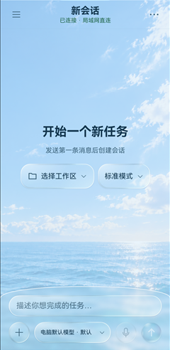

# DSHOS Link · DeepSeek Harness 鸿蒙伴侣

**电脑继续跑任务，你在手机上接着聊。**

DSHOS Link 是面向官方 **DeepSeek Harness（DSH）Windows 桌面端**的第三方插件与原生鸿蒙 App：在手机上继续电脑会话、补发图片和文件，任务完成时收到提醒。免费版在同一局域网内直连；跨网可使用 Pro 的端到端加密中继（需在手机端开通）。

当前版本：Windows 连接器 **0.2.20**（适配官方 DSH 桌面 **0.2.2-rc.5**）· 鸿蒙 App **1.1.2**（API 26 及以上）。[查看兼容性](#版本与兼容性)

*DeepSeek Harness (DSH) Windows plugin and native HarmonyOS companion app.*

[下载鸿蒙 App](https://dshoslink.cn/open) · [快速开始](#快速开始) · [升级已有安装](#升级已有安装) · [让 AI 帮你安装](#让-ai-小助手帮你安装) · [最近更新](#最近更新) · [版本与兼容性](#版本与兼容性) · [常见问题](#常见问题)

> **已升级到 DSH 0.2.2-rc.5？** 旧连接器可能无法正常加载。保存工作并完全退出 DSH 后，运行 `npx --yes @dshos-link/connector@latest upgrade`，会一并更新连接器和余额组件；原配对、会话和设置保留。[安装与升级说明](connector/docs/windows-installation.md)

## 让 AI 小助手帮你安装

**一句话，让你的 AI 小助手帮你装好 DSHOS Link。** 将下面这段话复制给 **DeepSeek Harness（DSH）桌面端里的 AI 助手**，让它按你的电脑情况协助安装：

```text
请帮我在这台 Windows 电脑的 DeepSeek Harness（DSH）桌面端安装 DSHOS Link 插件，让我能用鸿蒙手机继续电脑上的会话。
请先阅读最新安装说明：https://github.com/laoju188/dshoslink-connector/blob/main/connector/docs/windows-installation.md
检查本机环境和已有安装，按说明选择安装或升级，配齐升级助手与余额组件，保留原配对、会话和设置。
如果需要退出 DSH，请先准备好退出后的操作步骤，再提醒我保存任务并自行退出，不要强行关闭当前桌面。
装好并重新打开 DSH 后，请帮我核对实际安装版本和配套组件，并指导我完成手机配对；已有正常配对就沿用。需要我操作或还无法确认的地方，请直接说明。
```

AI 助手需要能够读取网页并操作本机；遇到权限确认或需要重开桌面时，按提示配合即可。如果当前助手不能执行安装，也可以使用下方的[快速开始](#快速开始)。

## 快速开始

### 环境要求

| 项目 | 要求 |
| --- | --- |
| 电脑 | Windows 10 / 11 |
| 桌面宿主 | 已初始化的官方 DeepSeek Harness 桌面版（当前适配 **0.2.2-rc.5**） |
| Node.js | **22.19 及以上的 22.x**，或 **24 及以上** |
| 鸿蒙手机 | **API 26 及以上**；当前正式版为 1.1.2 |
| 网络 | 免费版同一局域网直连；跨网使用 Pro 的加密中继；首次配对需电脑取得受支持的局域网地址 |

### 1. 安装鸿蒙 App

在华为应用市场搜索 **DSHOS Link** 安装，使用华为账号登录。也可以打开[鸿蒙下载页](https://dshoslink.cn/open)扫码或下载。

### 2. 在 Windows 安装连接器

先在 Windows 上安装并打开一次[官方 DeepSeek Harness 桌面端](https://www.deepseek.com/harness/)。保存工作并完全退出 DSH，在 PowerShell 运行：

```powershell
npx --yes @dshos-link/connector@latest install
```

完成后重新打开 DSH，在「应用 → 关于」核对桌面版本（当前适配 0.2.2-rc.5），在「插件 → DSHOS Link」核对连接器版本 **0.2.19**。

### 3. 配对两台设备

手机打开「配对 DSH」取得 8 位码，在电脑「插件 → DSHOS Link」输入并点击「连接手机」，再回手机核对、确认这台电脑。保持电脑开机联网、DSH 和连接器运行，然后从手机打开原会话或新建会话确认连接。

### 升级已有安装

- **连接器仍在 0.2.x、平时可正常使用**：保存工作并完全退出 DSH，在 PowerShell 运行 `npx --yes @dshos-link/connector@latest upgrade`，再重新打开 DSH。原配对、会话和设置保留。
- **DSH 已升级到 0.2.2-rc.5，或页面内更新不可用**：请使用与当前 DSH 桌面版本匹配的完整安装包，一起更新连接器和余额组件，避免只更新其中一项导致版本不匹配。入口见[Windows 安装与配对](connector/docs/windows-installation.md)和[页面内更新说明](connector/docs/one-click-upgrade.md)。
- 手机 App 通过华为应用市场更新，不需要重新配对。

## 界面预览

| 手机 · 继续原会话 | 鸿蒙桌面卡片 · 任务完成 |
| :---: | :---: |
|  |  |

*左：鸿蒙 App 新会话实拍。右：手机版 1.1.1 真机截帧（历史素材，界面细节以当前 1.1.2 为准）。*


*Windows 插件配对管理面板实拍。*

## 下载

用手机扫描下图打开鸿蒙下载页；电脑上也可以直接访问 [dshoslink.cn/open](https://dshoslink.cn/open)。

[](https://dshoslink.cn/open)

## 在鸿蒙手机上继续工作

- **回到原会话，或在电脑工作区新建任务。** 从手机查看电脑上的工作区和会话；新任务使用电脑端提供的模型、模式和推理等级。
- **随手补充材料。** 可以拍照、发送图片或文件，也可以把语音转成文字再发送。在会话中可引用回复、查看 GIF、播放 Agent 发来的语音，并在局域网内预览视频。
- **回复到了，手机会提醒你。** 开启通知后，可收到任务完成提醒，应用图标可显示未读数量。手机版 1.1.1 起提供**胖肥鱼桌面卡片**，显示任务状态和新回复；开启相应通知后，任务完成时卡片可以自动庆祝。点击卡片上的提示会打开对应会话，读完后同步减少未读角标。

## 在 Windows 的 DSH 中管理连接

- **配对和管理手机访问。** 在「插件 → DSHOS Link」输入手机显示的 8 位配对码，再回手机确认这台电脑。配对后可以从插件页暂停或恢复手机访问。
- **沿用桌面上的工作区和会话。** 电脑上的 DSH 负责运行任务；手机发来的消息进入对应会话，桌面返回的回复也能在手机查看。
- **处理断网、桌面重开和新版 DSH。** 0.2.15 起改进原配对恢复、待发消息和插件升级；0.2.19 适配 DSH 0.2.2-rc.5，并修复 DeepSeek 账号余额的精度与显示。余额组件可读取 DSH 账号或 API Key 余额，取决于桌面配置。

## 版本与兼容性

| 组件 | 当前说明 |
| --- | --- |
| 官方 DSH 桌面 | 适配 **0.2.2-rc.5**（官方预发行版）；兼容范围见[桌面兼容说明](connector/docs/dsh-desktop-compatibility.md) |
| Windows 连接器 **0.2.20** | 已发布至 npm，并同步本仓库源码。适配 DSH 0.2.2-rc.5，配套余额组件和升级助手 **0.1.6**。 |
| 鸿蒙 App **1.1.2** | 已通过华为审核的最新正式版，也是本次插件兼容基线；需要 **API 26 或更高版本**。市场实际可下载版本以应用市场页面为准。 |
| 鸿蒙 App **1.1.1** | 上一正式版，历史兼容与升级起点。 |

[连接器变更日志](CHANGELOG.md) · [npm 0.2.20](https://www.npmjs.com/package/@dshos-link/connector/v/0.2.20) · [DSH 桌面端兼容说明](connector/docs/dsh-desktop-compatibility.md)

## 最近更新

以下按**插件版本**记录更新；手机版进度见上方兼容表。默认展示最近三个版本，较早记录可点击展开。

<!-- 维护规则：新版本放在最前，始终保留最近三个版本展开；其余移入下方 details，并同步 CHANGELOG.md。 -->

### 0.2.20 · 配对码输入提示与网络重试（2026-11-27）

- 配对码输入框暂时不可输入时，输入框旁直接显示原因；不再出现“点了没反应”却没有任何说明的情况。
- 新增「重新检测网络」：立即重新检测电脑局域网地址（约 10 秒内只检测一次），后台仍会定期自动检测。
- 区分“电脑没有可用局域网地址”和“未能读取电脑网络信息”两类原因，分别给出提示。
- 已获审的鸿蒙手机版 **1.1.2/build192** 可继续使用；DSH 0.2.2-rc.5 和升级助手 0.1.6 保持不变。

### 0.2.19 · 适配 DSH 0.2.2-rc.5（2026-11-19）

- 支持官方 Windows **DSH 0.2.2-rc.5**，适配事件连接与对应版本的余额组件。
- 升级助手更新到 **0.1.6**，支持从 0.2.16 分发的 0.1.5 助手迁移并保留升级记录。
- 修复 DeepSeek 账号余额的精度合计与显示；负余额按分位取整。
- 桌面宿主升级后给出连接器与余额组件的恢复指引。
- 已获审的鸿蒙手机版 **1.1.2/build192** 可继续使用，原配对、会话和设置保留。

### 0.2.16 · 适配新版 DSH

- 支持 **DSH 0.2.2-rc.3**，同步适配会话事件与余额组件。
- 升级助手更新到 **0.1.5**，支持迁移上一版助手并保留升级记录。
- 兼容当时的正式手机版 **1.1.1**。

<details>
<summary>查看历史更新（0.2.15 及更早版本）</summary>

### 0.2.15 · 连接与消息恢复

- 支持 **DSH 0.2.2-rc.2**，适配新版消息队列和余额组件。
- 改善 DSH 重开、局域网地址变化后的原配对恢复。
- 保留待发消息和结果未知的提交状态，改进完成提醒、已读回执与升级恢复。

### 0.2.14 · 安装与升级完善

- 支持 **DSH 0.2.2-rc.1**，提供匹配桌面版本的余额组件。
- 内置升级助手 **0.1.3**，完善插件安装、升级与恢复路径。
- 隔离升级验证确认配对、会话和设置资料保持。

### 0.2.13

历史正式发行版，内置升级助手 0.1.2。可查看 [npm 0.2.13](https://www.npmjs.com/package/@dshos-link/connector/v/0.2.13) 的版本资料。

### 0.2.12

历史正式发行版，内置升级助手 0.1.2。可查看 [npm 0.2.12](https://www.npmjs.com/package/@dshos-link/connector/v/0.2.12) 的版本资料。

更早版本见 [npm 版本列表](https://www.npmjs.com/package/@dshos-link/connector?activeTab=versions)。历史包用于版本追溯，日常安装请使用最新版。

</details>

[查看完整变更日志](CHANGELOG.md)

## 常见问题

### 升级 DSH 后，连接器还能用吗？

0.2.20 已适配官方 DSH 0.2.2-rc.5。旧连接器遇到新宿主时可能无法正常加载，请按[升级已有安装](#升级已有安装)更新连接器和余额组件；原配对、会话和设置保留。页面内更新不可用时，使用与当前桌面版本匹配的完整安装包。

### 0.2.20 支持哪些 DSH 版本？

当前适配 **0.2.2-rc.5**，并识别 0.2.2-rc.1/rc.2/rc.3、0.2.1 系列和部分更早的官方版本；完整名单和页面内升级条件以[桌面兼容说明](connector/docs/dsh-desktop-compatibility.md)为准。官方新版本发布后需要重新适配，请按安装说明选择匹配的安装包。

### 鸿蒙手机需要什么系统版本？

需要 **API 26 或更高版本**。当前正式版是 **1.1.2**；旧版本已有的合法配对、会话和设置继续保留，建议使用应用市场最新版。

### 为什么配对码输入框点了没反应？

首次配对时，电脑需要先取得受支持的局域网地址；暂时没有可用地址时，配对码输入框会被禁用并显示“暂不可输入”，输入框旁会直接说明原因。请确认电脑连接常用 Wi‑Fi 或有线网络（VPN、虚拟网卡不能代替），点击「重新检测网络」立即重试（约 10 秒内一次），插件也会定期自动检测；仍不可输入时请点击「发送连接反馈」。云配对不要求手机和电脑在同一网络，但首次配对仍需要电脑先取得本地地址，详情见[Windows 安装与配对](connector/docs/windows-installation.md#首次配对与局域网地址)。

### 鸿蒙手机可以异地使用 DeepSeek Harness 吗？

手机和电脑处于不同网络时需要 Pro，通过端到端加密中继访问原会话。使用时请保持电脑开机联网，并让 DSH 和插件持续运行。

### 怎么添加胖肥鱼桌面卡片？

手机版 **1.1.1 起**支持：长按鸿蒙桌面的 DSHOS Link 图标，从卡片预览中添加 2×2 卡片。在 App 内开启「关键通知」并允许系统通知，电脑任务完成后卡片就可以自动更新和庆祝。

### 手机版 1.1.0 积累了很多未读回复，为什么角标没有及时更新？

1.1.0 的提醒同步有容量限制，大量未读时角标可能暂时不同步，聊天仍可继续。这项同步修复随手机版 1.1.1 提供。

### 支持哪些平台？有没有独立网页版或 PC 客户端？

当前只支持**官方 Windows DSH 桌面版 + 鸿蒙手机 App**；不提供独立网页版或单独的 PC 产品。Android/其他平台不在本仓库范围内。

## 安全与隐私

配对使用长期电脑身份与手机系统安全存储；局域网直连使用配对身份的加密连接，Pro 中继使用端到端加密。插件提供默认开启、可随时关闭的配对诊断，只上传有限的配对阶段、固定错误类别和耗时，不上传聊天内容、文件、配对码或密钥。反馈时请隐去配对码、账号信息和聊天内容。[配对诊断说明](connector/docs/pairing-diagnostics.md)

## 开源与贡献

本仓库提供 **Windows 连接器**的源码、构建脚本和测试；鸿蒙 App 与服务端不在本仓库内。连接器自有源码采用 MIT 许可，第三方组件沿用各自许可；npm 安装包附有对应版本的《DSHOS Link Connector Use License》。

欢迎在 Issues 分享实际遇到的配对、升级和会话使用问题，也欢迎提交 PR。

[提交问题或建议](https://github.com/laoju188/dshoslink-connector/issues) · [从源码构建](connector/docs/building-windows-package.md) · [MIT 许可](LICENSE) · [第三方许可](connector/THIRD_PARTY_NOTICES.md)
