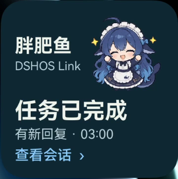
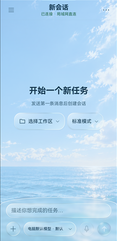
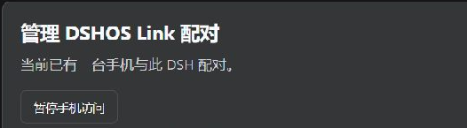

# DSHOS Link · DeepSeek Harness 鸿蒙伴侣

**电脑继续跑任务，你在手机上接着聊。**

DSHOS Link 是面向 **DeepSeek Harness（DSH）Windows 桌面端**的第三方插件与原生鸿蒙 App。在手机上继续电脑会话、补发图片和文件，任务完成时收到提醒。同一局域网内可免费直连。

*DeepSeek Harness (DSH) Windows plugin and native HarmonyOS companion app.*

[下载鸿蒙 App](https://dshoslink.cn/open) · [安装或升级插件](#快速开始) · [版本与兼容性](#版本与兼容性)

| 胖肥鱼桌面卡片 · 任务完成 | 鸿蒙 App · 新建会话 |
| :---: | :---: |
|  |  |

*左侧为手机版 1.1.1 的真机验收录屏截帧。右侧为鸿蒙 App 的新会话实拍。*

## 在鸿蒙手机上继续工作

- **回到原会话，或在电脑工作区新建任务。** 从手机查看电脑上的工作区和会话。新任务使用电脑端提供的模型、模式和推理等级。
- **随手补充材料。** 可以拍照、发送图片或文件，也可以把语音转成文字再发送。在会话中可引用回复、查看 GIF、播放 Agent 发来的语音，并在局域网内预览视频。
- **回复到了，手机会提醒你。** 开启通知后，可收到任务完成提醒，应用图标可显示未读数量。1.1.1 新增的**胖肥鱼桌面卡片**会显示任务状态和新回复。开启相应通知后，任务完成时卡片可以自动庆祝。点击卡片上的提示会打开对应会话，读完后同步减少未读角标。

## 在 Windows 的 DeepSeek Harness 中管理连接

- **配对和管理手机访问。** 在「插件 → DSHOS Link」输入手机显示的 8 位配对码，再回手机确认这台电脑。配对后，可以从插件页暂停或恢复手机访问。
- **沿用桌面上的工作区和会话。** 电脑上的 DSH 负责运行任务。手机发来的消息进入对应会话，桌面返回的回复也能在手机查看。
- **处理断网和桌面重开。** 0.2.15 改进了沿用原配对恢复访问、待发消息恢复和插件升级。配套余额组件支持读取 DSH 账号或 API Key 的余额，具体取决于桌面的配置。



*Windows 插件 0.2.1 实拍，截取配对管理面板。*

## 版本与兼容性

| 组件 | 当前说明 |
| --- | --- |
| Windows 连接器 **0.2.15** | 已发布至 npm。新增对官方 Windows DSH **0.2.2-rc.2** 的适配，包括新版消息队列和余额组件。 |
| 鸿蒙 App **1.1.0** | 已验证可搭配连接器 0.2.15 使用。 |
| 鸿蒙 App **1.1.1** | 已提交华为应用市场审核，下载版本以市场页面为准。需要 **API 26 或更高版本**，新增胖肥鱼桌面卡片，改善提醒和已读同步、发送状态、日夜主题弹层和横屏显示。 |

[连接器变更日志](CHANGELOG.md) · [npm 0.2.15](https://www.npmjs.com/package/@dshos-link/connector/v/0.2.15) · [DSH 桌面端兼容说明](connector/docs/dsh-desktop-compatibility.md)

## 快速开始

1. **鸿蒙手机安装 DSHOS Link。** 在华为应用市场搜索 **DSHOS Link**，安装后使用华为账号登录。也可以直接打开 [鸿蒙下载页](https://dshoslink.cn/open)。

2. **Windows 安装连接器。** 先安装并打开一次 [官方 DeepSeek Harness 桌面端](https://www.deepseek.com/harness/)。准备 Node.js **22.19 及以上的 22.x** 或 **24 及以上**，完全退出 DSH，在 PowerShell 运行命令，再重新打开 DSH。

   ```powershell
   npx --yes @dshos-link/connector@latest install
   ```

3. **配对两台设备。** 手机上打开「配对 DSH」，把 8 位码填到电脑的「插件 → DSHOS Link」，点击「连接手机」，然后在手机核对并确认。

### 已安装插件

保存工作并完全退出 DSH，在 PowerShell 运行以下命令，再重新打开 DSH。原配对可继续使用。已升级 DSH 至 **0.2.2-rc.2**、插件仍为 **0.2.14** 的用户，请用这条命令一起更新连接器和余额组件。

```powershell
npx --yes @dshos-link/connector@latest upgrade
```

[Windows 安装与配对](connector/docs/windows-installation.md) · [页面内更新说明](connector/docs/one-click-upgrade.md)

用手机扫描下图可打开鸿蒙下载页。

[](https://dshoslink.cn/open)

## 常见问题

### 鸿蒙手机可以异地使用 DeepSeek Harness 吗？

手机和电脑处于不同网络时需要 Pro，通过端到端加密连接访问原会话。使用时请保持电脑开机联网，并让 DSH 和插件持续运行。

### 怎么添加胖肥鱼桌面卡片？

安装手机版 1.1.1 后，长按鸿蒙桌面的 DSHOS Link 图标，从卡片预览中添加 2×2 卡片。在 App 内开启「关键通知」并允许系统通知，电脑任务完成后卡片就可以自动更新和庆祝。

### 手机版 1.1.0 积累了很多未读回复，为什么角标没有及时更新？

1.1.0 的提醒同步有容量限制，大量未读时角标可能暂时不同步，聊天仍可继续。这项同步修复随手机版 1.1.1 提供。

## 开源与贡献

本仓库提供 **Windows 连接器**的源码、构建脚本和测试。仓库中连接器自有源码采用 MIT 许可，第三方组件沿用各自许可。npm 安装包附带对应版本的《DSHOS Link Connector Use License》。原生鸿蒙 App 经应用市场分发，配套服务由项目维护。

欢迎在 Issues 分享实际遇到的配对、升级和会话使用问题，也欢迎提交 PR。反馈时请隐去配对码、账号信息和聊天内容。

[提交问题或建议](https://github.com/laoju188/dshoslink-connector/issues) · [从源码构建](connector/docs/building-windows-package.md) · [MIT 许可](LICENSE) · [第三方许可](connector/THIRD_PARTY_NOTICES.md)
